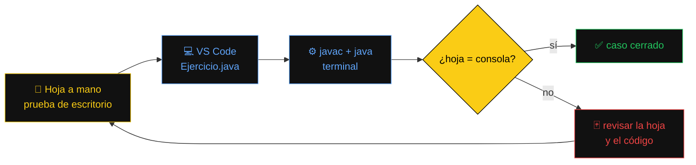
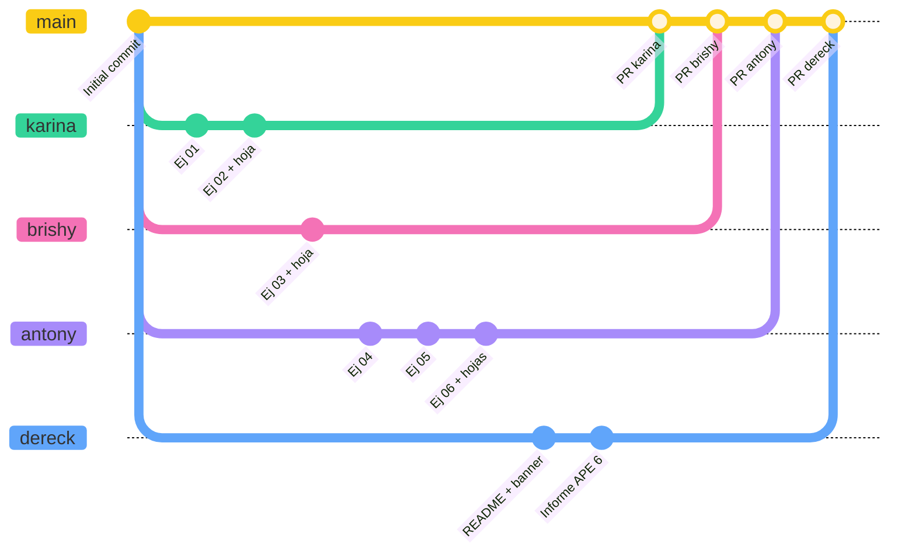

<a name="inicio"></a>

<div align="center">


<p>


</p>
<p>


</p>


**En Gotham, nadie trabaja con una variable por sospechoso: se usa un arreglo.**

[🦇 Caso](#-el-caso) ·
[📡 Batseñal](#-transmisión-de-la-batseñal) ·
[🦸 Batfamilia](#-la-batfamilia) ·
[🌿 Ramas](#-el-protocolo-de-la-baticueva--ramas-issues-y-pull-requests) ·
[🗺️ Mapa](#️-mapa-de-gotham) ·
[📁 Casos](#-distrito-1--primera-parte) ·
[🧰 Batcinturón](#-batcinturón--arreglos-y-javautilarrays) ·
[🃏 Villanos](#-galería-de-villanos) ·
[📄 Informe](#-el-expediente-final)

</div>


## 🦇 El caso

> *«Siete gastos, diez turnos, n estudiantes… nadie en Gotham declara una variable para cada uno.»*

En la **APE 6 – Arreglos y Listas** aprendimos a guardar muchos datos del mismo tipo en una sola estructura y a recorrerla con `for`: acumular, promediar, contar con condiciones, buscar, encontrar máximos y mínimos con arreglos paralelos y usar la clase `java.util.Arrays`.

Cada caso se resolvió **primero a mano** en el cuaderno y después en **Visual Studio Code**. La regla fue simple: **lo que dice la hoja tiene que coincidir con lo que dice la consola.**




## 📡 Transmisión de la Batseñal

> **📻 Comisionado Gordon → Baticueva**
>
> *«Tenemos seis casos y todos son listas de datos: gastos de una semana, piezas por turno, notas de un curso, números sospechosos, un ranking y un registro que hay que ordenar sin perder el original. Necesito resultados exactos, comprobados a mano.»*
>
> — *Transmisión recibida. La Batfamilia toma el caso.* 🦇


## 🦸 La Batfamilia

| | Detective | Alter ego en Gotham | Rama | Misión | Orden |
| :---: | :--- | :--- | :---: | :--- | :---: |
| 📡 | **Sánchez Bastidas Karina Paola** | **Oráculo** · guardiana del repositorio | `karina` | Casos 01 y 02 · une los Pull Requests | [#2](../../issues/2) |
| 🦇 | **Ashanga Yumbo Brishy Anahy** | **Batgirl** · analista de rendimiento | `brishy` | Caso 03 | [#3](../../issues/3) |
| 🛡️ | **Casillas Ochoa Antony Sebastián** | **Red Hood** · cazador de datos | `antony` | Casos 04, 05 y 06 | [#4](../../issues/4) |
| 🐦 | **Paredes Acosta Dereck Shair** | **Robin** · guardián del expediente | `dereck` | Informe final en PDF (formato APE) | [#5](../../issues/5) |
| 🌃 | **Calderón Carvajal Fher Dorian** | **Nightwing** · coordinador | — | Plan, ramas, órdenes y este README | [#1](../../issues/1) |

<div align="center">

</div>

> [!IMPORTANT]
> **Regla de la Baticueva:** nadie sube directo a `main`. Cada detective trabaja en su rama y entra con un Pull Request que Oráculo revisa.


## 🌿 El protocolo de la Baticueva · Ramas, Issues y Pull Requests



| Issue | Para | Orden |
| :---: | :--- | :--- |
| [#1](../../issues/1) | Toda la Batfamilia | 📋 Plan general: reparto, estructura y reglas |
| [#2](../../issues/2) | 📡 Karina | Subir casos 01 y 02 + hoja a mano · unir los PR |
| [#3](../../issues/3) | 🦇 Brishy | Subir caso 03 + hojas a mano |
| [#4](../../issues/4) | 🛡️ Antony | Subir casos 04, 05 y 06 + hojas a mano |
| [#5](../../issues/5) | 🐦 Dereck | Subir el informe final de la APE 6 en PDF |


## 🗺️ Mapa de Gotham

<table>
<tr>
<td valign="top" width="50%">

**🌃 Distrito 1 · Primera parte**

| # | Caso | Detective |
| :---: | :--- | :---: |
| 01 | 💸 Gastos semanales e inflación | 📡 Karina |
| 02 | 🏭 Filtro y suma de producción | 📡 Karina |
| 03 | 🎓 Asistencia y rendimiento | 🦇 Brishy |

</td>
<td valign="top" width="50%">

**🏙️ Distrito 2 · Segunda parte**

| # | Caso | Detective |
| :---: | :--- | :---: |
| 04 | 🔎 Búsqueda y conteo | 🛡️ Antony |
| 05 | 🏆 Máximo y mínimo paralelos | 🛡️ Antony |
| 06 | 🧰 Integrador con `Arrays` | 🛡️ Antony |

</td>
</tr>
</table>

```text
Programacion_APE6/
├── Ejercicio1/Ejercicio1.java
├── Ejercicio2/Ejercicio2.java
├── Ejercicio3/Ejercicio3.java
├── Ejercicio4/Ejercicio4.java
├── Ejercicio5/Ejercicio5.java
├── Ejercicio6/Ejercicio6.java
├── HojasAMano/            Ejercicios_1_y_2.pdf · Ejercicio_3.pdf · Ejercicios_4_5_6.pdf
├── Informe/               Informe_APE6.pdf
├── assets/                gotham-banner.svg · gotham-footer.svg
└── README.md
```

<div align="center">

</div>

## 🌃 Distrito 1 · Primera parte

### 💸 Caso 01 · Control de gastos semanales y ajuste por inflación

| 🔎 Pista | 📂 Detalle |
| :--- | :--- |
| **Archivo** | [`Ejercicio1.java`](./Ejercicio1/Ejercicio1.java) |
| **Detective** | 📡 Karina · rama `karina` |
| **Gadgets** | `double[7]`, acumulador, promedio, `* 1.10`, recorrido inverso `i--` |
| **Misión** | Registrar 7 gastos, sacar total y promedio, subir 10 % a los días sobre el promedio y mostrar todo al revés. |

<details>
<summary><b>🖥️ Ver salida en la Batcomputadora</b></summary>

```text
Ingrese el gasto del día 1: 12.50
Ingrese el gasto del día 2: 8
Ingrese el gasto del día 3: 15.75
Ingrese el gasto del día 4: 20
Ingrese el gasto del día 5: 9.30
Ingrese el gasto del día 6: 30
Ingrese el gasto del día 7: 10

Gasto total: 105.55
Promedio diario: 15.078571428571427

Gastos actualizados en orden inverso:
Día 7: 10.0
Día 6: 33.0
Día 5: 9.3
Día 4: 22.0
Día 3: 17.325000000000003
Día 2: 8.0
Día 1: 12.5

Días con incremento: 3
```

</details>

> [!NOTE]
> El `17.325000000000003` no es un error: es cómo `double` representa `15.75 × 1.10`. A mano da `17.33`.

---

### 🏭 Caso 02 · Filtro y suma condicionada de producción

| 🔎 Pista | 📂 Detalle |
| :--- | :--- |
| **Archivo** | [`Ejercicio2.java`](./Ejercicio2/Ejercicio2.java) |
| **Detective** | 📡 Karina · rama `karina` |
| **Gadgets** | `int[10]`, `i % 2 == 0`, `produccion[i] % 2 != 0 && > 15`, `printf("%.2f")` |
| **Misión** | Sumar las piezas de los índices pares, contar turnos impares mayores a 15 y sacar el promedio con 2 decimales. |

<details>
<summary><b>🖥️ Ver salida en la Batcomputadora</b></summary>

```text
Ingrese las piezas del turno 1: 12
Ingrese las piezas del turno 2: 17
Ingrese las piezas del turno 3: 9
Ingrese las piezas del turno 4: 21
Ingrese las piezas del turno 5: 15
Ingrese las piezas del turno 6: 19
Ingrese las piezas del turno 7: 8
Ingrese las piezas del turno 8: 25
Ingrese las piezas del turno 9: 14
Ingrese las piezas del turno 10: 23

Suma de indices pares: 58
Turnos con produccion impar mayor a 15: 5
Promedio general: 16.30
```

</details>

---

### 🎓 Caso 03 · Análisis de asistencia y rendimiento

| 🔎 Pista | 📂 Detalle |
| :--- | :--- |
| **Archivo** | [`Ejercicio3.java`](./Ejercicio3/Ejercicio3.java) |
| **Detective** | 🦇 Brishy · rama `brishy` |
| **Gadgets** | `new int[n]`, `do-while` de validación, `(double) suma / n` |
| **Misión** | Pedir n notas válidas (0–20), sacar el promedio, contar aprobados (≥ 14) y reprobados, y listar a los que están bajo el promedio. |

<details>
<summary><b>🖥️ Ver salida en la Batcomputadora</b></summary>

```text
Ingrese la cantidad de estudiantes: 0
Ingrese la cantidad de estudiantes: 5
Nota del estudiante 1: 18
Nota del estudiante 2: 12
Nota del estudiante 3: 25
Error. Ingrese una nota entre 0 y 20.
Nota del estudiante 3: 15
Nota del estudiante 4: 9
Nota del estudiante 5: 20

Promedio general: 14.8
Estudiantes aprobados: 3
Estudiantes reprobados: 2

Estudiantes con notas por debajo del promedio:
Estudiante 2 - Nota: 12
Estudiante 4 - Nota: 9
```

</details>

> [!TIP]
> El `0` y el `25` se escribieron a propósito: prueban las dos validaciones.

<div align="center">

</div>

## 🏙️ Distrito 2 · Segunda parte

### 🔎 Caso 04 · Búsqueda y conteo

| 🔎 Pista | 📂 Detalle |
| :--- | :--- |
| **Archivo** | [`Ejercicio4.java`](./Ejercicio4/Ejercicio4.java) |
| **Detective** | 🛡️ Antony · rama `antony` |
| **Gadgets** | búsqueda lineal, contador, bandera `posicion = -1` |
| **Misión** | Buscar un número en `{14, 7, 25, 3, 18, 7, 30}`, decir cuántas veces aparece y su primera posición. |

<details>
<summary><b>🖥️ Ver salida en la Batcomputadora</b></summary>

```text
Ingrese un numero: 7
Aparece 2 veces
Primera posicion: 1

Ingrese un numero: 99
No existe.
```

</details>

---

### 🏆 Caso 05 · Máximo y mínimo con arreglos paralelos

| 🔎 Pista | 📂 Detalle |
| :--- | :--- |
| **Archivo** | [`Ejercicio5.java`](./Ejercicio5/Ejercicio5.java) |
| **Detective** | 🛡️ Antony · rama `antony` |
| **Gadgets** | `String[]` + `int[]` paralelos, `posMax`, `posMin` |
| **Misión** | Mostrar quién tiene la nota más alta, la más baja y el promedio con 2 decimales. |

<details>
<summary><b>🖥️ Ver salida en la Batcomputadora</b></summary>

```text
Nota mas alta: Marta con 18
Nota mas baja: Luis con 8
Promedio: 13.00
```

</details>

---

### 🧰 Caso 06 · Integrador con java.util.Arrays

| 🔎 Pista | 📂 Detalle |
| :--- | :--- |
| **Archivo** | [`Ejercicio6.java`](./Ejercicio6/Ejercicio6.java) |
| **Detective** | 🛡️ Antony · rama `antony` |
| **Gadgets** | `Arrays.copyOf`, `Arrays.sort`, `Arrays.toString`, `Arrays.binarySearch` |
| **Misión** | Copiar, ordenar solo la copia, hallar el segundo mayor y la posición del 14. |

<details>
<summary><b>🖥️ Ver salida en la Batcomputadora</b></summary>

```text
Original: [14, 7, 25, 3, 18]
Copia ordenada: [3, 7, 14, 18, 25]
Segundo numero mayor: 18
Posicion del 14 en la copia: 2
```

</details>


## 🧰 Batcinturón · Arreglos y java.util.Arrays

| Gadget | Qué hace | Casos |
| :--- | :--- | :---: |
| 📦 `tipo[] nombre = new tipo[n]` | Crea un arreglo de tamaño fijo | 01, 02, 03 |
| 🧾 `{14, 7, 25, …}` | Crea y llena el arreglo en una sola línea | 04, 05, 06 |
| 📏 `arreglo.length` | Tamaño del arreglo; el último índice es `length - 1` | 01–06 |
| 🔁 `for (i = 0; i < length; i++)` | Patrullaje de inicio a fin | 01–06 |
| ⏪ `for (i = length - 1; i >= 0; i--)` | Recorrido inverso | 01 |
| 🎯 `(double) suma / n` | Evita la división entera | 02, 03, 05 |
| 🚩 `posicion = -1` | Bandera de «todavía no lo encuentro» | 04 |
| 👥 `posMax` / `posMin` | Guardan el **índice**, no el valor | 05 |
| 📋 `Arrays.copyOf` | Copia real: el original no cambia | 06 |
| 🔃 `Arrays.sort` | Ordena de menor a mayor | 06 |
| 🖨️ `Arrays.toString` | Muestra el arreglo como `[a, b, c]` | 06 |
| 🔍 `Arrays.binarySearch` | Busca rápido, **solo** en arreglos ordenados | 06 |


## ⚙️ Activar la Batcomputadora

```bash
git clone https://github.com/Karina-com/Programacion_APE6.git
cd Programacion_APE6/Ejercicio3
javac Ejercicio3.java
java Ejercicio3
```

> [!NOTE]
> En Visual Studio Code: abrir la carpeta, abrir la terminal con **Ctrl + ñ** (o **Ctrl + \`**) y ejecutar los mismos comandos.


## 🃏 Galería de villanos

| Villano | Su crimen con arreglos | Cómo lo detuvimos | Caso |
| :--- | :--- | :--- | :---: |
| 🃏 **El Joker** | `ArrayIndexOutOfBoundsException` por usar `i <= length` | Recorrer con `i < length` | 01–06 |
| 🪙 **Dos Caras** | `suma / n` con enteros pierde los decimales | `(double) suma / n` | 02, 03, 05 |
| 🧊 **Mr. Freeze** | Un `if` sin `contador++` deja el conteo congelado en 0 | Escribir el incremento dentro del `if` | 02 |
| 😱 **El Espantapájaros** | Un curso con `n = 0` estudiantes | `do { … } while (n <= 0)` | 03 |
| 💪 **Bane** | Notas de 25 o negativas | Validar el rango 0–20 antes de guardar | 03 |
| 🐧 **El Pingüino** | Guardar solo la primera aparición… o la última | Bandera `posicion == -1` | 04 |
| 🪟 **Clayface** | `copia = datos` no copia: los dos cambian | `Arrays.copyOf(datos, datos.length)` | 06 |
| ❓ **El Acertijo** | `binarySearch` en un arreglo desordenado | Ordenar primero con `Arrays.sort` | 06 |

<details>
<summary><b>🧊 Mr. Freeze y el contador congelado</b></summary>
<br>

—Alfred, la hoja dice que hay 5 turnos impares mayores a 15… y la consola dice 0.

—Señor, el `if` está ahí, pero nadie le dijo `contadorImpares++`. El contador se quedó congelado.

**Desde entonces, la Batfamilia compara la hoja con la consola antes de cerrar un caso.**

</details>

<details>
<summary><b>❓ El acertijo final</b></summary>
<br>

*«Te digo dónde está algo en un instante, pero solo si todo está en orden. Si no, te miento sin avisar. ¿Quién soy?»*

**Respuesta:** `Arrays.binarySearch()`.

</details>


## 📄 El expediente final

| Documento | Responsable | Ubicación |
| :--- | :--- | :--- |
| 📘 Informe APE 6 (formato UTA, PDF) | 🐦 Dereck | [`Informe/Informe_APE6.pdf`](./Informe/Informe_APE6.pdf) |
| ✍️ Hojas a mano | Cada detective | [`HojasAMano/`](./HojasAMano) |

El informe incluye, para cada caso: enunciado, explicación, hoja a mano, código en VS Code, ejecución en la terminal y una tabla que compara el cálculo a mano con la consola.

<div align="center">


**Algoritmos y Lógica de Programación · Ing. José Rubén Caiza Caizabuano · Julio – Diciembre 2026**

*Primero lo resolvimos a mano. Luego lo programamos. Y si no coincidía, lo depuramos juntos.*

[⬆️ Volver a la Baticueva](#inicio)

<sub>Proyecto académico sin fines comerciales · Universidad Técnica de Ambato · Batman y sus personajes pertenecen a DC Comics.</sub>


</div>
